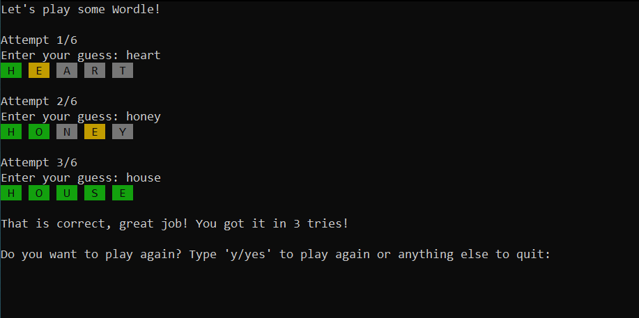

# Console Wordle

A simple Wordle clone for the Windows console written in C++20.

It features Wordle's original scoring rules with colored letter tiles, input validation, and a word list (from which a random word is selected as the answer at the start of each game) loaded from 
a text file with invalid lines skipped.

## How to play

You have six attempts to guess a five-letter word. After each guess, every letter is colored:

- **Green**: right letter in the correct position
- **Yellow**: the letter is in the word, but in a different position
- **Gray**: the letter isn't in the word

You can play again with a different word after you guess correctly or run out of attempts.

## Building and running

Requires Windows 10 or later and Visual Studio 2026 with the "Desktop development with C++" workload.

1. Open `Wordle/Wordle.slnx` in Visual Studio.
2. Select the **Release** configuration and build it.
3. Run the game from Visual Studio, or double-click `Wordle/x64/Release/Wordle.exe` on the project folder.

`words.txt` is copied next to the executable during the build. The game looks for it in the current working directory, so when running the executable directly, run it from its own folder.

## Some notes

- **Repeated letters.** Scoring runs in two passes: exact (green) matches first, then yellows from a pool of the answer's unused letters. For example, guessing `EERIE` against `CRANE` gives one green E and two gray Es, matching the original game.
- **Cleaning input early.** Guesses and lines from the word file are trimmed, validated, and uppercased as soon as they're read, so the rest of the code can assume clean five-letter words.
- **Error handling when loading.** `readWords` returns a `std::optional`. I could've used a `bool` return value with an output reference parameter instead but for this project I wanted to keep the data flow simpler.

## Limitations and what I may add next

- Guesses aren't checked against a dictionary to see if the user entered a valid word, so any five letters are accepted.
- The word list is relatively small (77 words). It also contains a few deliberately invalid lines to show how the loader handles them.